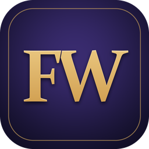
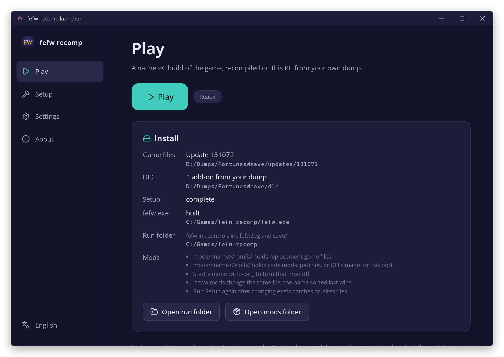
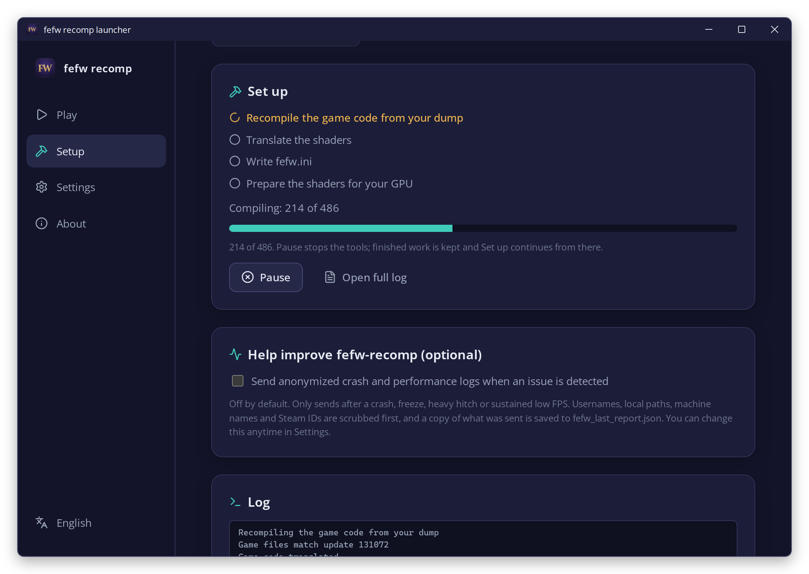
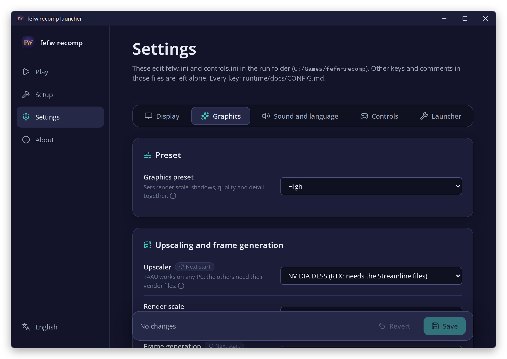
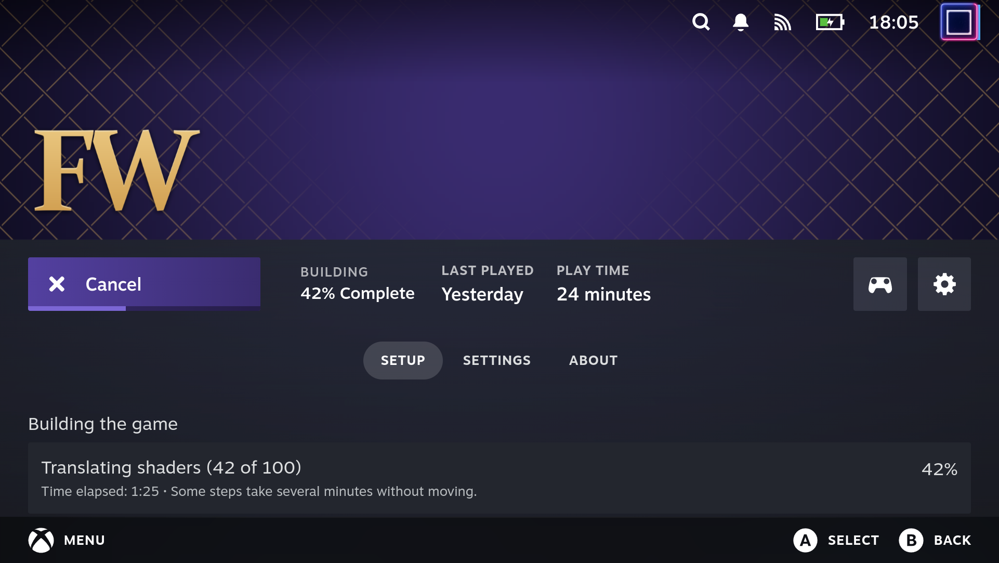
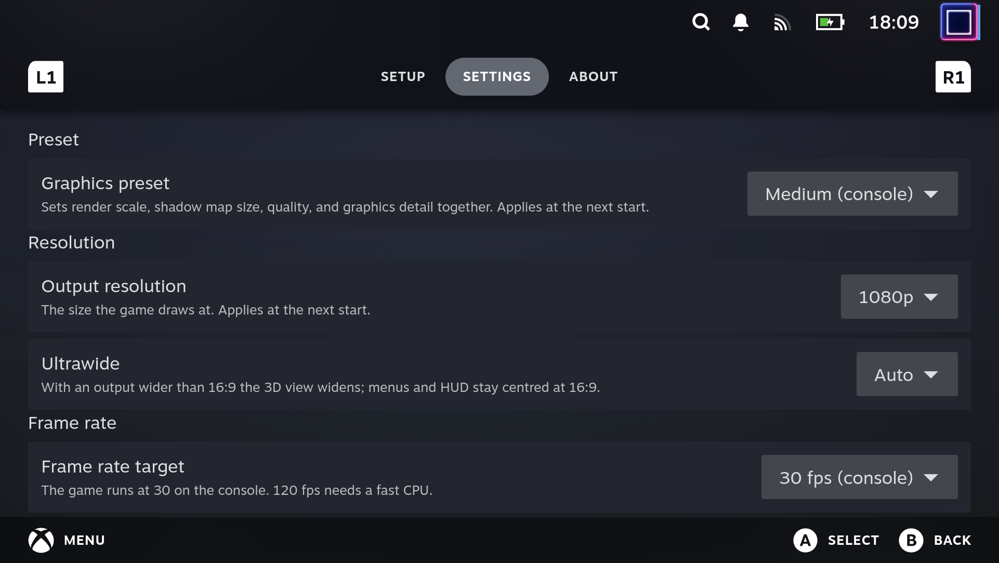

#  fefw-recomp

A native Windows PC port of **Fire Emblem: Fortune's Weave** (Nintendo Switch 2), made by static recompilation. The game's code is
translated to C++ and compiled into a regular Windows program, which runs on a small runtime that stands in for the console's system
software and draws with Vulkan. It is not an emulator. It also runs on Linux and handhelds through Proton.

<a href="https://recomplauncher.com/game/fefw-recomp"><picture><source media="(prefers-color-scheme: dark)" srcset="https://recomplauncher.com/assets/press/launcher/badge-light.svg"></picture></a>
<a href="https://github.com/metrist38/fefw-recomp/releases/latest"><picture><source media="(prefers-color-scheme: dark)" srcset="docs/badges/windows-light.svg"></picture></a>
<a href="https://github.com/metrist38/fefw-recomp/releases/latest/download/fefw-recomp-install.desktop"><picture><source media="(prefers-color-scheme: dark)" srcset="docs/badges/handheld-light.svg"></picture></a>

**How to install:** [Windows](#windows) · [Steam Deck and other handhelds](#steam-deck-and-other-handhelds) · [desktop Linux](#linux)

> [!IMPORTANT]
> **No game files are included or downloadable here.** This project contains only its own tools and runtime. To play, you need your
> own legally dumped copy of the game ([requirements](#requirements)); everything that reads the game happens on your PC. See
> [LEGAL.md](LEGAL.md).
>
> Not affiliated with or endorsed by Nintendo or Intelligent Systems.

## The launcher

## Install

### Windows

1. Download `fefw-recomp-<version>-win64.zip` from the [latest release](../../releases/latest) and extract it to its own folder.
2. Run `fefw-launcher.exe`.
3. On **Setup**, choose your dump folder (or **.nup** file) and press **Set up**. The launcher checks your files, builds the game on
   your PC and prepares the shaders. The first setup takes a while; you can **Pause** it and continue later.
4. Press **Play**.

Your saves are in the `save\` folder next to the launcher.

On a screen smaller than 2560x1440, such as a handheld's, the first **Set up** lowers the output resolution to 1080p or 720p to
suit it. **Settings > Display > Output resolution** changes it.

### Steam Deck and other handhelds

The quickest way on a handheld with Steam's Game Mode, such as a Steam Deck or one running Bazzite or CachyOS Handheld:

1. Switch to **Desktop Mode** and download `fefw-recomp-install.desktop` from the [latest release](../../releases/latest). If your
   browser saves it ending in `.download`, remove that ending.
2. Open the file (choose to run it if asked). It installs the game (or uses the install you already have), offers
   [Decky Loader](https://github.com/SteamDeckHomebrew/decky-loader) if it is missing, installs this project's Decky plugin and adds
   the game to your Steam library with artwork, asking before each step.
3. In the launcher it opens, choose your dump and press **Set up**. You still need your own dump, and about 30 GB of free space.
4. Switch back to Game Mode and open the game in your library. On the game's Steam page, the **FEFW Recomp** Decky plugin replaces
   Steam's default tabs with **Setup**, **Settings** and **About**, and turns the Play button into **Set up** (or **Cancel** with
   progress) when the game needs building or is updating. The same controls are also in the Quick Access Menu.

Installing the plugin needs administrator rights. If your account has no password, the installer can use a temporary one and remove
it right afterwards. Run the installer again to finish a step you skipped, or to update the plugin.
[installer/README.md](installer/README.md) has the details.

The plugin is early. This has been tried on CachyOS Handheld, not yet on SteamOS or Bazzite; reports are welcome. On Bazzite, install
Decky Loader first with `ujust setup-decky`.

### Linux

On desktop Linux, or to set a handheld up by hand: download `fefw-recomp-<version>-linux-x64.tar.gz` from the
[latest release](../../releases/latest), extract it and run `fefw-launcher.AppImage`; the steps are the same as on Windows. The game
runs through Proton: Play needs Steam with a Proton installed, [umu-launcher](https://github.com/Open-Wine-Components/umu-launcher)
(`umu-run`) or Wine, or press **Add to Steam** on the Play page and start it from Steam (also in the Steam Deck's Game Mode).

FSR 3 frame generation does not work through Proton, so the Linux launcher offers [LSFG-VK](https://lsfg-vk.dev) instead (it needs
Lossless Scaling on Steam). **Settings > Graphics** can install the layer, and shows its multiplier, flow scale and performance mode
once it is found.

### Updating

The game says at start when a newer release is out (**F1 > Game** turns that check off). On the launcher's **About** page, update to
it: your saves, settings and built game stay. You can also extract the new package over the old folder.

If the launcher then asks, run **Set up** again before playing. This matters when you start the game from Steam: on a handheld, do it
in Desktop Mode, or with the plugin's **Build the game**.

## Requirements

- Windows 10 or 11, 64-bit, or Linux with Proton or Wine
- A 64-bit CPU with SSE4.2 and POPCNT: an Intel Core i3 / i5 / i7 (2008) or newer, or an AMD FX (2011) / Ryzen or newer
- A GPU with Vulkan 1.3 and an up-to-date driver
- 16 GB of RAM and about 30 GB of free disk space
- Your own decrypted dump of the game at update **131072**, in one of these forms:
  - a folder with `exefs\` and `romfs\`
  - a dump folder with `base\` and `updates\<version>\`
  - a [`.nup`](https://github.com/a55uka/nup) package

Older processors

Setup builds the game for your processor: CPUs with FMA3 (Intel Haswell 2013, AMD Piledriver 2012 and newer) get the faster build,
older ones such as Sandy Bridge, Ivy Bridge and Xeon E5 v1 / v2 a compatible build that plays the same, a little slower. Older
processors (Core 2, AMD Phenom) are not supported; Setup and `fefw.exe` say so instead of crashing.

## Features

**Picture**

- 60 or 120 FPS modes, any output resolution and render scale
- Ultrawide (21:9, 32:9 or any wider shape): a wider view with the menus and HUD kept at 16:9 in the centre
- A built-in temporal upscaler, DLSS, FSR 3 and XeSS upscaling, and DLSS or FSR 3 frame generation
- HDR output, with the menus and HUD brightness set apart from the 3D scene
- Windowed, borderless or fullscreen

**Controls**

- Keyboard, mouse or any controller, with matching button prompts
- HD Rumble on DualSense and Pro Controller (cable or Bluetooth), and all four motors on Xbox controllers

**Game and setup**

- A launcher that sets everything up from your dump, with nothing else to install
- The game in all its languages, and your own dumped DLC
- RomFS mods, exefs code patches and DLL code mods
- An in-game settings overlay (**F1**)

**Linux and handhelds**

- Runs through Proton, with LSFG-VK frame generation
- On Steam Deck-style handhelds: a [one-file installer](#steam-deck-and-other-handhelds) and a Decky plugin to play, update and
  change settings from Game Mode

## Playing

### Settings

The launcher's **Settings** page covers resolution, frame rate, upscaling, window mode, sound and controls. Press **F1** in game for
the overlay. Every option is described in [runtime/docs/CONFIG.md](runtime/docs/CONFIG.md).

### Upscaling and frame generation

The built-in upscaler needs nothing extra. For DLSS, FSR 3 or XeSS, download the vendor's files in the launcher under
**Settings > Graphics > Upscaler files**. [docs/UPSCALERS.md](docs/UPSCALERS.md) covers what each one needs and adding the files by
hand.

### Controls

Any controller works, and so do the keyboard and mouse, with no setup. **F1** opens the settings, **F2** shows the frame rate and
**Alt+Enter** switches full screen. [docs/CONTROLS.md](docs/CONTROLS.md) lists the keys and mouse controls and how to change them.

### DLC and mods

Your own dumped DLC and RomFS, exefs and DLL mods are supported. A DLL mod runs with the same rights as the game: only install mods
you trust. See [docs/MODS.md](docs/MODS.md).

### Mods

The launcher's **Mods** page imports `.ips` / `.ips32` patches or folders containing a mod manifest. Patches must match the
selected game's Build ID. Importing leaves a mod disabled; enable it, then return to **Setup** to rebuild the PC game. Disabling a
patch also requires a rebuild. The original game dump is not modified. The current interface supports ExeFS `main` instruction
patches only; supported runtime packages appear in the in-game F1 Mods tab after restarting the game. Runtime packages
require a matching game runtime implementation; a manifest alone does not execute arbitrary code. See
[tools/mods/README.md](tools/mods/README.md) for the manifest format, validation limits and checkout build layout.

### Launcher and menu language

The launcher and the F1 menu come in English and Simplified Chinese and start in your system's language. To change it, use the
language button at the foot of the launcher's sidebar; the choice covers both.

**Translations are welcome.** The launcher and the F1 menu each take their own file: start from
[template.json](launcher/locales/template.json) for the launcher ([how](launcher/src/locales/README.md)) and from
[zh.ini](locales/zh.ini) for the menu ([how](locales/README.md)). Send them as a pull request or attach them to an
[issue](../../issues). A partial translation is fine, as anything missing shows in English. The F1 menu may not yet display scripts
such as Korean or Japanese properly; if yours looks wrong, say so.

### Game language

**Settings > Sound and language** (or **F1 > Game**) picks the language of the game's text and voices: Japanese, English (US or UK),
French, German, Italian, Spanish, Korean and Chinese (Simplified or Traditional). *Automatic*, the default, follows your Windows
display language and uses English when the game has no translation for it. The change applies the next time the game starts.

## Troubleshooting

- **"These game files are a different version"**: only update 131072 is supported. Check that you dumped the update, not only the
  base game.
- **Setup stopped or failed**: press **Set up** again to continue where it stopped. **Open full log** on the Setup page shows what
  went wrong.
- **The game closes or freezes**: look at `fefw.log` in the launcher's folder, and update your GPU driver.

## Reporting problems

Open an [issue](../../issues) with `fefw.log`, your GPU, driver and Windows version, and the release you used. Please do not attach
game files or anything made from them.

## Building from source

See [docs/BUILDING.md](docs/BUILDING.md). Contributions are welcome.

## Credits

This project stands on the work of others. Thank you.

- [Goldoire](https://github.com/Goldoire), who created fefw-recomp and made every release up to 0.2.0.
- The forks whose work has been ported here: [xinthefreefallxai/ObeliskChamber](https://github.com/xinthefreefallxai/ObeliskChamber)
  (fixes, performance and frame pacing changes), [stephenjayakar/fefw-recomp](https://github.com/stephenjayakar/fefw-recomp) (Stephen
  Jayakar: the recompiler, stutter and PGO performance work) and [Kompas9/fefw-recomp](https://github.com/Kompas9/fefw-recomp) (Paulius:
  the alpha test shader variant, shader preparation at Set up, the tutorial pager's D-pad prompts and quieter logs).
- [XiONDiGiTaL/EmblemWeave](https://github.com/XiONDiGiTaL/EmblemWeave): the settings panels for code mods, by
  [Mi-Kel](https://github.com/Mi-Kel), taken here by way of ObeliskChamber.
- Everyone who has sent changes to this repository, among them moistman7, Paulius, Stellarznith, Abubakar-ux, ranbinrang-rgb, itaskaev2
  and Ruben Ripalda.
- [nxrecomp](https://github.com/drakolordx7/nxrecomp) by drakolordx7: the recompiler this is built on.
- [pokopia-recomp](https://github.com/drakolordx7/pokopia-recomp) (drakolordx7) and [featureJosh/pokopia-recomp](https://github.com/featureJosh/pokopia-recomp)
  (featureJosh): the runtime, tools and launcher this project started from (GPL-3.0).
- [drakolordx7/switch2-recomp](https://github.com/drakolordx7/switch2-recomp): the launcher design this launcher follows.
- [nxnative-penis6](https://git.eden-emu.dev/penis6/nxnative-penis6) by seedds (MIT): the movie decoder front end, its dav1d copy and
  several hardware facts (notices in `runtime/THIRD_PARTY_NOTICES.md`).
- [Kompas9's Switch-Game-Patches](https://github.com/Kompas9/Switch-Game-Patches) (MIT): the Fortune's Weave ultrawide patch, whose sites and
  findings `[fefw] ultrawide` re-implements as runtime hooks.
- [Fortune's Eden](https://github.com/TheSneakyBadger/FEFW-Stable-with-60-FPS-Patch) by TheSneakyBadger (GPL-3.0-or-later), whose map
  started from Jbuck7's 60 FPS cheat: the per-frame sites and scaling rule `[fefw] frame_fixes` re-implements as runtime hooks.
- [Ryujinx / Ryubing](https://git.ryujinx.app/ryubing/ryujinx) (MIT): the shader translator and tiling code; [Mesa](https://gitlab.freedesktop.org/mesa/mesa) NAK (MIT).
- SuperMarioWonderRecomp (MIT); smo-recomp, ScarletNX and ssbu-recomp (GPL-3.0); [yuzu and Eden](https://git.eden-emu.dev/eden-emu/eden)
  (GPL); libnx (ISC); LLVM libc++abi (Apache-2.0 with LLVM exceptions).
- [Hookshot](https://github.com/NotRexed/Hookshot) (GPL-3.0) and SkyboundTotk: the RomFS mod folder layout and rules followed here, so
  mods work the same in both.
- [zbic](https://github.com/kinnay/zbic) by Yannik Marchand (GPLv2; installed by pip at setup, not included here): ZBIC decompression.
- [dav1d](https://code.videolan.org/videolan/dav1d) (BSD-2-Clause), [libvpx](https://chromium.googlesource.com/webm/libvpx) (BSD-3-Clause),
  [Zstandard](https://github.com/facebook/zstd) (BSD), [SDL3](https://github.com/libsdl-org/SDL) (zlib), volk, VulkanMemoryAllocator, Dear ImGui (MIT),
  Vulkan-Headers (Apache-2.0 or MIT).
- [astc-encoder](https://github.com/ARM-software/astc-encoder) (Apache-2.0), [bc7enc_rdo](https://github.com/richgel999/bc7enc_rdo)
  (MIT or public domain), ISPC (BSD-3-Clause).
- AMD FidelityFX / FSR SDK headers (MIT), NVIDIA Image Scaling (MIT), NVIDIA Streamline headers (MIT). No AMD, Intel or NVIDIA binaries
  are included in this repository or its releases. If you ask it to, the launcher downloads the FSR, XeSS and DLSS files from the
  vendors' own GitHub repositories to your PC, where they stay the vendors' files under the vendors' licences.
- [Sascha Willems' Vulkan samples](https://github.com/SaschaWillems/Vulkan) (MIT): the stand-in shader test corpus.
- [Kenney input prompts](https://kenney.nl/assets/input-prompts) (CC0), DejaVu fonts, [Tauri](https://tauri.app), [Lucide](https://lucide.dev) icons (ISC).

Licence texts: `runtime/THIRD_PARTY_NOTICES.md`, `recomp/THIRD_PARTY.md`, `tools/*/licenses/`, `tools/textures/THIRD_PARTY.md` and the
licence files inside `runtime/third_party/`. All of these licences are compatible with the GPL-3.0 this project is released under.

## License

GPL-3.0 ([LICENSE](LICENSE)). Third-party code keeps its own licence.
